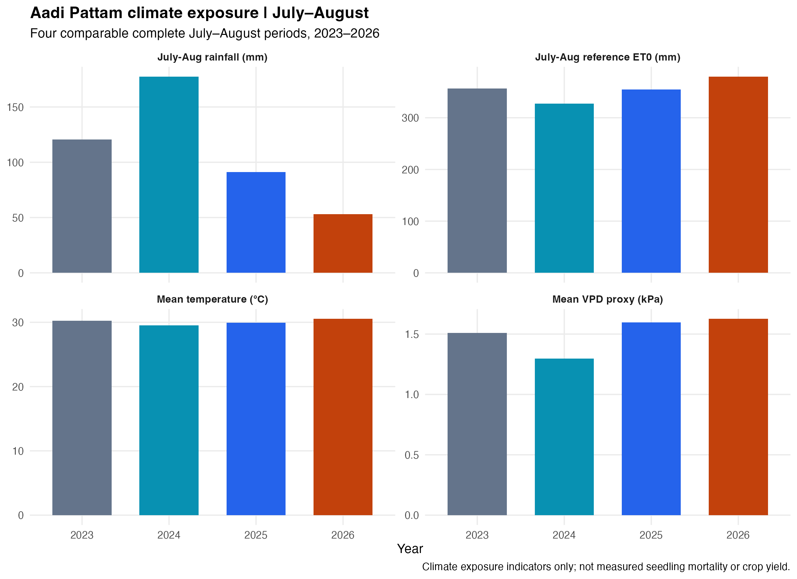

# Beyond Rainfall: Climate Exposure around Aadi Pattam (2023–2026)

**A reproducible R analysis of sampled weather conditions in the Cauvery Delta agricultural belt and adjoining coast, South India.**

This study asks whether weather conditions during the **Chithirai–Vaikasi (April–June)** period and the **Aadi Pattam (July–August)** establishment window differed in 2023–2026, and what the resulting atmospheric demands imply for climate-informed crop management.



## Key results

From eight sampling points (six distinct modelled rainfall grid series), July–August 2026 had **52.9 mm sampled mean-grid rainfall**, compared with **91.3 mm in 2025**, **177.5 mm in 2024** and **120.7 mm in 2023**. Reference ET₀ was **379.6 mm** in 2026, the highest of the four July–August windows. The eight-point daily-mean maximum temperature was above 35°C on **42 of 62 days** in 2026, compared with **24 days** in 2025. Mean relative humidity was **63.1% in 2026** and **62.9% in 2025**—not evidence of a major humidity decline.

The 2026 April–June pre-Aadi period also had lower sampled rainfall than the corresponding period in each of the other three years, although it **does not establish antecedent soil-water depletion or a causal effect on seedling survival**.

Read [Results and Discussion](RESEARCH_REPORT.md) for methods, comparisons and limits.

## Visual analysis

- [01 — Month-by-month weather variables](outputs/01_month_by_month_2023_2026.png): rainfall, ET₀, temperature, humidity and approximate VPD; the partial October 2026 month is flagged
- [02 — Four Aadi Pattam seasons](outputs/02_aadi_pattam_four_years.png): July–August totals and means
- [03 — Timing of Aadi rainfall](outputs/03_aadi_cumulative_rainfall.png): cumulative July–August precipitation
- [04 — Atmospheric dryness over Aadi](outputs/04_aadi_vpd_timeline.png): seven-day VPD proxy
- [05 — Summer to Aadi](outputs/05_apr_jun_to_jul_aug.png): daily-normalized indicators, April–June versus July–August
- [06 — Temperature and VPD](outputs/06_daily_max_temperature_and_vpd.png): high-frequency patterns during establishment

## Reproduce the study in RStudio

Requires **R** and **ggplot2**. No Python, API keys, or additional downloads are necessary.

```r
install.packages("ggplot2") # only once if not installed
source("analysis.R", chdir = TRUE)
```

The script reads `data/full_apr2023_oct2026.csv` and recreates summary CSVs and PNG plots in `outputs/`. It finds its own source directory, so it can also be sourced using its absolute path.

**Data provenance:** The included analysis-compatible CSV was **reconstructed from the successfully generated R `daily_by_site.csv` output** to make the repository independently runnable; it is *not* an untouched original API download. The 2023–2026 results and figures were generated in RStudio from the source data. See [DATA_PROVENANCE.md](DATA_PROVENANCE.md).

## Methodology in brief

- **Area:** Eight locations: Thanjavur, Kumbakonam, Tiruvarur, Mannargudi, Mayiladuthurai, Sirkazhi, Nagapattinam and Karaikal. Karaikal is in the adjoining Puducherry territory.
- **Time:** April 1, 2023–October 10, 2026; October 2026 is incomplete.
- **Source:** Gridded historical weather series accessed from Open-Meteo, with an ERA5-based selection (not local rain gauges).
- **Variables:** Precipitation, daily mean temperature, relative humidity, FAO-56 reference evapotranspiration (provided by the data service), and VPD estimated from daily mean T and RH. The six-figure workflow also uses daily maximum temperature and modelled maximum VPD where available.
- **Summary method:** Eight site-point mean for temperature, humidity, ET₀ and VPD proxy; six nonduplicate precipitation grid series for rainfall. These are **not** area-weighted official Cauvery Delta Zone averages.
- **Interpretation:** Observed *modelled weather exposure*, not measured plant injury, soil-water deficit, farm irrigation demand, ENSO attribution or proven water savings.

## Outputs and next steps

The analysis offers a weather-informed basis for testing sowing-date adjustment, rainfall monitoring, soil-moisture sensing, field microclimate monitoring, irrigation-scheduling and crop-establishment protection. Field trials are required before recommending quantitative interventions.

This project is complete as a **descriptive weather-data analysis**, not as a validated crop-damage prediction or irrigation-saving model.

## Attribution

Contains modified Copernicus Climate Change Service information, accessed via [Open-Meteo Historical Weather API](https://open-meteo.com/en/docs/historical-weather-api). [Copernicus Climate Data Store](https://cds.climate.copernicus.eu/). Neither the European Commission nor ECMWF is responsible for uses of the adapted products. Please check the data-provider terms before redistribution or commercial reuse.
